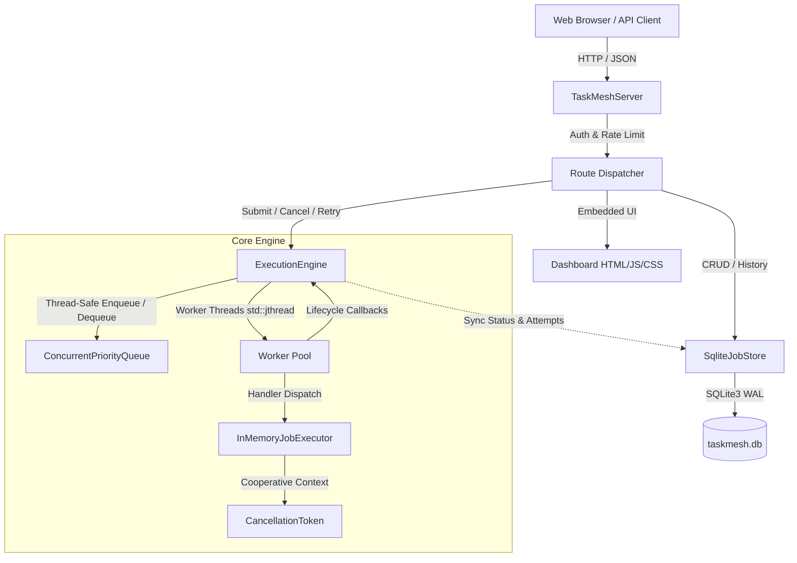
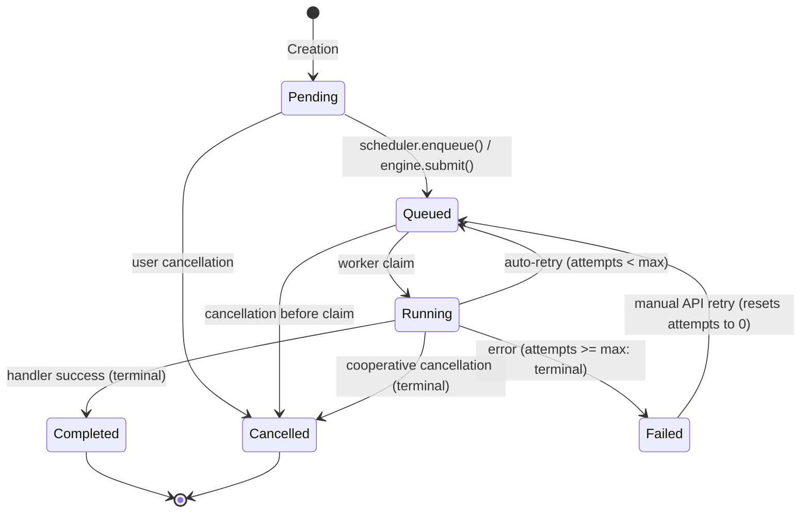

# TaskMesh Architecture Specification

## 1. Overview and Design Philosophy

**TaskMesh** is a high-performance, concurrent background job-processing platform written in modern C++20. It provides deterministic priority scheduling, microsecond-accurate lifecycle tracking, cooperative task cancellation, automatic and manual retries, persistent SQLite storage with crash recovery, a secure HTTP REST API, and an embedded responsive web dashboard.

The architecture emphasizes:
- **Correctness and Determinism**: Array-backed binary max-heap with 64-bit monotonic sequence numbers guarantees strict FIFO dequeue ordering for equal-priority tasks.
- **Problem-Driven DSA Selection**: Every data structure and algorithm is chosen based on operational requirements, cache locality, and complexity trade-offs (detailed in [docs/dsa_design_decisions.md](dsa_design_decisions.md)).
- **Concurrency & Resource Safety**: RAII ownership, modern `std::jthread` worker threads with cooperative `CancellationToken`, condition-variable synchronization, and strict exception isolation.
- **Durable Persistence & Crash Recovery**: Embedded SQLite with Write-Ahead Logging (`WAL`), ACID transaction guarantees, and automatic recovery of interrupted jobs upon server restart.
- **Self-Contained Embedded Operations**: The complete REST API, SQLite storage, and responsive web dashboard are compiled into a standalone native binary with zero external runtime dependencies.

---

## 2. Component Architecture Graph



---

## 3. Domain Model Architecture

### 3.1 Job Identifier (`JobId`)
- Strongly typed value object wrapping `std::string`.
- **Validation Invariants**:
  - Length: $1 \le \text{length} \le 128$.
  - Character set: Alphanumeric characters `[a-zA-Z0-9]` and safe punctuation `[-_.:]`.
  - Rejects whitespace, control characters, path delimiters (`/`, `\`), and shell metacharacters.
- Value semantics: Equality comparable, spaceship operator (`<=>`), streamable.

### 3.2 Job Priority (`JobPriority`)
- Strongly typed priority wrapper over `int32_t`.
- Standard levels:
  - `Low` (10)
  - `Normal` (50) — default
  - `High` (100)
  - `Critical` (200)
- Supports arbitrary integer priorities with strict monotonic ordering: higher numerical value indicates strictly higher scheduling precedence.

### 3.3 Lifecycle State Machine (`JobStatus`)

The job lifecycle transitions through a strictly validated directed state graph. Illegal transitions throw `JobValidationError`.



#### Valid Transitions:
| From State | Permitted Target States | Description / Trigger |
|:---|:---|:---|
| `Pending` | `Queued`, `Cancelled` | Initial state upon builder construction. |
| `Queued` | `Running`, `Cancelled` | Awaiting worker claim; can be cancelled pre-execution. |
| `Running` | `Completed`, `Failed`, `Cancelled`, `Queued` | Executed by worker; moves to `Queued` on auto-retry. |
| `Failed` | `Queued`, `Cancelled` | Terminal failure; can be manually re-queued via `/api/v1/jobs/:id/retry`. |
| `Completed` | *None* | Permanent terminal state. Cannot be retried or transitioned. |
| `Cancelled` | *None* | Permanent terminal state. Cannot be cancelled again. |

---

## 4. Deterministic Priority Scheduling

### 4.1 In-Memory Max-Heap & Monotonic Sequence Counter
The core scheduling data structure is a binary max-heap (`std::priority_queue`) backed by a contiguous `std::vector`:
- **Max-Heap Property**: Jobs with higher `JobPriority` values migrate to the root.
- **Deterministic FIFO Tie-Breaking**: Standard binary heaps are unstable. To enforce FIFO ordering among equal-priority jobs, each enqueued entry is tagged with a monotonic 64-bit sequence counter `sequence_counter_`.
- **Comparator Semantics**:
  ```cpp
  if (lhs.job.priority() != rhs.job.priority()) {
      return lhs.job.priority() < rhs.job.priority(); // Higher priority dequeued first
  }
  return lhs.sequence_number > rhs.sequence_number;   // Lower sequence (earlier arrival) dequeued first
  ```

### 4.2 Time and Space Complexity
| Operation | Time Complexity | Space Complexity | Description |
|:---|:---:|:---:|:---|
| `enqueue(Job)` | $O(\log N)$ | $O(1)$ amortized | Pushes into max-heap; increments sequence counter. |
| `dequeue()` | $O(\log N)$ | $O(1)$ | Extracts top element and reheapifies. |
| `peek()` | $O(1)$ | $O(1)$ | Inspects the root element without removing it. |
| `size()` | $O(1)$ | $O(1)$ | Returns count of pending jobs. |
| `clear()` | $O(N)$ | $O(1)$ | Drains queue and resets sequence counter to zero. |

### 4.3 Concurrent Thread-Safe Queue (`ConcurrentPriorityQueue`)
Wraps the priority scheduler with concurrency primitives:
- **Synchronization**: `std::mutex` and `std::condition_variable`.
- **Blocking Waits**: `pop_wait(timeout)` allows worker threads to sleep efficiently without busy-waiting.
- **Graceful Shutdown**: `close(graceful=true)` prevents new external submissions while allowing workers to drain existing queued jobs and enqueue retry attempts (`push_retry`).
- **Immediate Purge**: `drain_all()` extracts all pending jobs for rapid teardown.

---

## 5. Concurrent Worker Execution Engine

### 5.1 Worker Pool (`ExecutionEngine`)
- Configurable pool of worker threads managed with `std::jthread`.
- Workers pop jobs from `ConcurrentPriorityQueue`, claim them, and dispatch them to the configured `IJobExecutor`.
- **Exception Isolation**: Worker loops catch all standard and unexpected exceptions thrown by job handlers, preventing individual job failures from crashing the engine.

### 5.2 Linearized Cancellation Protocol
Cancellation guarantees clear linear semantics across lifecycle states:
1. **Pre-Execution Cancellation**: If a job is cancelled while in `Queued` status, the worker inspects the cancellation token before invoking the handler, marks the job `Cancelled` immediately, and skips handler execution.
2. **Cooperative In-Execution Cancellation**: Running handlers periodically poll `JobExecutionContext::is_cancellation_requested()`. Upon observing the signal, handlers abort cleanly and return `ExecutionResult::cancelled(...)`.
3. **Post-Terminal Rejection**: Cancelling a job that has already completed or failed returns `false` / `409 Conflict`.

### 5.3 Automated & Manual Retries
- **Automatic Engine Retries**: If `ExecutionEngineConfig.auto_retry` is enabled and a job fails with `attempt_count < max_attempts`, the engine automatically re-enqueues the job with an optional backoff delay.
- **Manual REST API Retries**: For jobs in `Failed` or `Cancelled` states, clients can trigger `POST /api/v1/jobs/:id/retry`, resetting the attempt counter to 0 and re-submitting to the scheduler.

### 5.4 Thread-Safe Metrics Invariant
The engine maintains strict atomic metrics satisfying the invariant at all times:
$$\text{submitted} = \text{queued} + \text{running} + \text{completed} + \text{failed} + \text{cancelled}$$
Engine metrics also track total execution retries without violating the job state balance.

---

## 6. Durable Storage & Crash Recovery

### 6.1 SQLite Database Schema (`SqliteJobStore`)
Persistent job metadata and history are stored in an embedded SQLite database configured with Write-Ahead Logging:
- **`PRAGMA journal_mode = WAL;`**: Allows concurrent readers without blocking writes.
- **`PRAGMA synchronous = NORMAL;`**: Balances durability with high transaction throughput.
- **Schema**:
  ```sql
  CREATE TABLE IF NOT EXISTS jobs (
      id TEXT PRIMARY KEY,
      type TEXT NOT NULL,
      payload TEXT NOT NULL,
      priority INTEGER NOT NULL,
      status INTEGER NOT NULL,
      attempt_count INTEGER NOT NULL DEFAULT 0,
      max_attempts INTEGER NOT NULL DEFAULT 3,
      error_details TEXT,
      creation_time INTEGER NOT NULL,
      scheduled_time INTEGER NOT NULL,
      created_at INTEGER NOT NULL,
      updated_at INTEGER NOT NULL
  );
  CREATE INDEX IF NOT EXISTS idx_jobs_status_prio ON jobs(status, priority DESC, creation_time ASC);
  ```

### 6.2 Crash Recovery
When `TaskMeshServer` starts:
1. `SqliteJobStore::recover_uncompleted_jobs()` inspects the database for jobs left in `Running` state from a prior crash or abrupt termination.
2. If `job.can_retry()` is true, the job is transitioned back to `Queued` and scheduled into the execution engine.
3. If attempts are exhausted, the job is marked `Failed` with reason `"Server process terminated during execution"`.
4. All existing `Queued` jobs are re-enqueued into the engine's priority queue in correct priority/FIFO order.

---

## 7. HTTP REST API & Security

### 7.1 Server Architecture (`TaskMeshServer`)
Built on `cpp-httplib` with JSON serialization via `nlohmann/json`.

### 7.2 Security & Rate Limiting
- **Authentication**: All mutation endpoints require an API token passed via `Authorization: Bearer <token>` or `X-API-Key: <token>`. Configurable via CLI argument or `TASKMESH_API_KEY` environment variable.
- **Sliding-Window IP Rate Limiting**: Tracks requests per client IP address. Exceeding `rate_limit_per_minute` immediately yields `HTTP 429 Too Many Requests`.

### 7.3 REST Endpoints

| Method | Endpoint | Auth | Description |
|:---|:---|:---:|:---|
| `GET` | `/health` | No | Liveness probe returning `200 OK` and uptime. |
| `GET` | `/ready` | No | Readiness probe verifying SQLite database connectivity. |
| `GET` | `/` or `/dashboard` | No | Serves embedded single-page responsive web dashboard. |
| `POST` | `/api/v1/jobs` | Yes | Submit new job. Returns `201 Created` or `409 Conflict` (duplicate ID). |
| `GET` | `/api/v1/jobs` | No | List jobs with optional `?status=`, `?limit=`, and `?offset=`. |
| `GET` | `/api/v1/jobs/:id` | No | Retrieve detailed status, payload, attempts, and errors for a job. |
| `POST` | `/api/v1/jobs/:id/cancel` | Yes | Cancel queued or running job. Returns `409` if already terminal. |
| `POST` | `/api/v1/jobs/:id/retry` | Yes | Re-queue failed or cancelled job with reset attempts. Returns `409` if running/completed. |
| `DELETE` | `/api/v1/jobs/:id` | Yes | Delete job record. Protected against deleting active `Running` jobs (`409`). |
| `GET` | `/api/v1/metrics` | No | Live engine metrics snapshot with invariant validation flag. |
| `GET` | `/api/v1/stats` | No | Database job distribution counts grouped by status. |

---

## 8. Embedded Responsive Web Dashboard

The web dashboard is served directly from the compiled binary via `src/dashboard_html.cpp`:
- **Zero External Dependencies**: All CSS, SVG icons, and JavaScript logic are self-contained.
- **Modern Glassmorphic Dark UI**: Curated color palette (emerald, violet, amber, rose) with subtle card elevations, micro-animations, and responsive layouts for mobile and desktop screens.
- **Live Metric Gauges**: Dynamically animated cards displaying Submitted, Queued, Running, Completed, Failed, and Cancelled counts.
- **Live Search & Filter**: Real-time client-side search by Job ID, type, payload, or error message, paired with status filter pills (`All`, `Queued`, `Running`, `Completed`, `Failed`, `Cancelled`).
- **Job Submission Modal**: Form with automatic UUID generation, preset payload templates, priority selector (`Low`, `Normal`, `High`, `Critical`), and max attempts configuration.
- **Interactive Job Details Inspector**: Full JSON payload viewer, error details banner, attempt progress, and one-click action buttons.
- **In-Table Contextual Actions**: Quick actions to Inspect, Cancel (queued/running), Retry (failed/cancelled), or Delete (terminal jobs).
- **Persistent API Key Management**: Modal saving API credentials into browser `localStorage`, automatically attaching authentication headers to all requests.
- **Toast Notifications**: Non-intrusive animated notifications for all user operations.

---

## 9. Verification & Test Suite Summary

TaskMesh is validated through 75 automated tests across 7 distinct GoogleTest suites running in both Debug and Release configurations on MSVC C++20:

| Test Suite | Test Count | Focus Area |
|:---|:---:|:---|
| `JobTest` | 14 | Domain entity validation, ID character rules, priority ordering, attempt limits, and lifecycle transitions. |
| `PrioritySchedulerTest` | 13 | Binary heap max-priority scheduling, monotonic 64-bit FIFO tie-breaking, empty handling, and queue clearing. |
| `JobExecutorTest` | 9 | Handler dispatch, error handling, lifecycle transitions, terminal job rejection, attempt exhaustion, and metric consistency. |
| `ConcurrentPriorityQueueTest` | 6 | Thread-safe push/pop, timed waiting, graceful draining, immediate purge, and multi-producer multi-consumer concurrency stress. |
| `ExecutionEngineTest` | 11 | Worker pool dispatch, pre-execution cancellation, cooperative cancellation, terminal cancellation rejection, graceful shutdown, handler exception isolation, load invariant checking, automatic retries, and lifecycle callbacks. |
| `SqliteJobStoreTest` | 6 | Database roundtrip, status updates, pagination/filtering, crash recovery of interrupted jobs, exhausted attempt handling, and record deletion. |
| `TaskMeshServerTest` | 16 | Liveness/readiness probes, metrics invariant API, token authentication, payload validation, lifecycle HTTP roundtrips, duplicate ID conflict (`409`), manual retries, completed retry rejection (`409`), active job deletion guards (`409`), and retry attempt reset persistence. |
| **Total** | **75** | **100% Pass Rate in both Debug and Release builds** |
