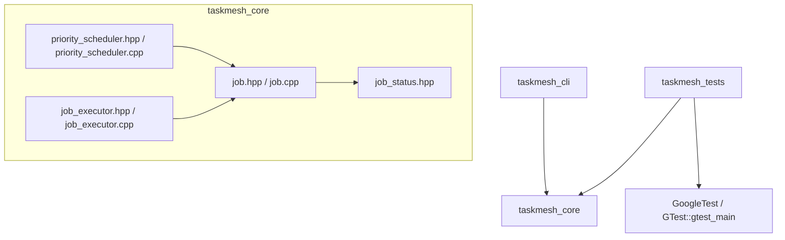
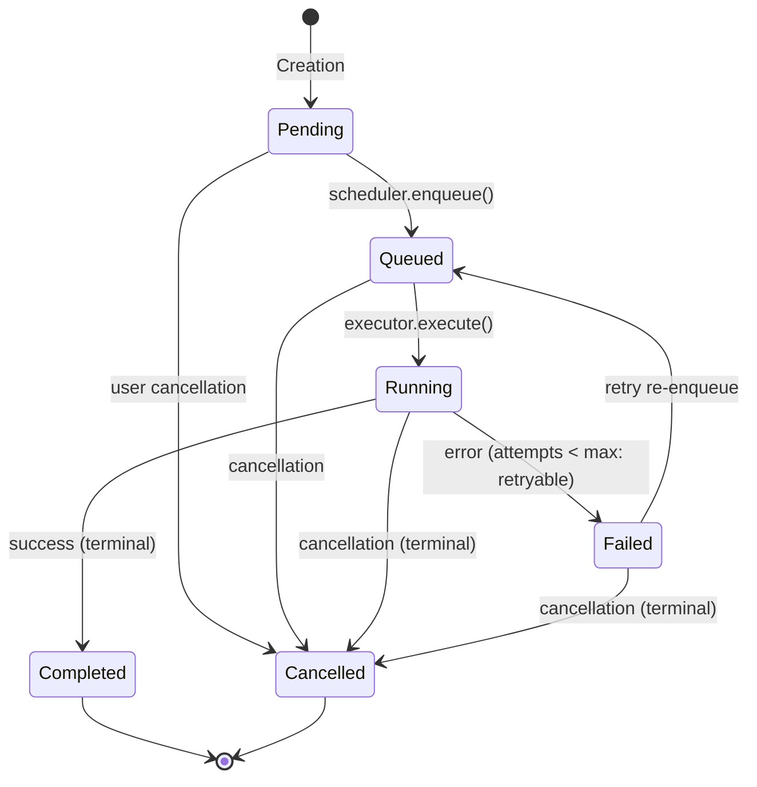

# TaskMesh Architecture Specification (Phase 1)

## 1. Overview and Design Philosophy

TaskMesh is an asynchronous job-processing platform designed for mission-critical background task execution. Phase 1 establishes the core in-memory engineering foundation: a strongly typed domain model, an in-memory priority scheduler with deterministic FIFO tie-breaking, an execution abstraction decoupling scheduling from execution, and an automated test suite.

The architecture emphasizes:
- **Correctness Before Features**: No premature distributed claims; core algorithmic correctness is rigorously proven first.
- **Explicit Domain Modeling**: All entity identifiers, status transitions, and priority values are strictly typed and validated at construction and mutation boundaries.
- **Predictable Complexity**: Strict $O(\log N)$ enqueue/dequeue guarantees with cache-friendly contiguous vector backing.
- **Resource Safety**: Complete RAII compliance and zero manual memory management.

---

## 2. Component Dependency Graph



---

## 3. Domain Model Architecture

### 3.1 Job Identifier (`JobId`)
- Encapsulates string identifiers.
- **Validation Invariants**:
  - Length: $1 \le \text{length} \le 128$.
  - Character set: Alphanumeric characters `[a-zA-Z0-9]` and safe punctuation `[-_.:]`.
  - Rejects whitespace, control characters, path delimiters (`/`, `\`), and shell metacharacters.
- Value semantics: Equality comparable, spaceship operator (`<=>`), streamable.

### 3.2 Job Priority (`JobPriority`)
- Strongly typed priority wrapper over `int32_t`.
- Predefined standards:
  - `Low` (10)
  - `Normal` (50) — default
  - `High` (100)
  - `Critical` (200)
- Supports arbitrary integer priorities with strict monotonic ordering: higher numerical value indicates strictly higher scheduling precedence.

### 3.3 Lifecycle State Machine (`JobStatus`)

The job lifecycle transitions through a directed state graph. Illegal transitions throw `JobValidationError`.



#### Valid Transitions:
| From State | Permitted Target States | Notes |
|:---|:---|:---|
| `Pending` | `Queued`, `Cancelled` | Cannot jump straight to `Completed` or `Running`. |
| `Queued` | `Running`, `Cancelled` | Selected by worker executor. |
| `Running` | `Completed`, `Failed`, `Cancelled` | Execution outcome. |
| `Failed` | `Queued`, `Cancelled` | May only re-queue if `attempt_count < max_attempts`. |
| `Completed` | *None* | Permanent terminal state. |
| `Cancelled` | *None* | Permanent terminal state. |

---

## 4. Priority Scheduler (`PriorityScheduler`)

### 4.1 Algorithmic Design
The scheduler is an in-memory priority queue structured around `std::priority_queue` backed by `std::vector`:
- **Max-Heap Property**: Jobs with higher `JobPriority` values migrate to the root.
- **Deterministic FIFO Tie-Breaking**: Standard binary heaps are not stable. To enforce FIFO ordering among equal-priority jobs, each enqueued entry is tagged with a monotonic 64-bit sequence counter `sequence_counter_`.
- **Comparator Semantics**:
  ```cpp
  if (lhs.job.priority() != rhs.job.priority()) {
      return lhs.job.priority() < rhs.job.priority(); // Higher priority dequeued first
  }
  return lhs.sequence_number > rhs.sequence_number;   // Lower sequence (earlier arrival) dequeued first
  ```

### 4.2 Time and Space Complexity

| Operation | Time Complexity | Space Complexity | Description |
|:---|:---:|:---:|:---|
| `enqueue(Job)` | $O(\log N)$ | $O(1)$ amortized | Pushes into max-heap; increments sequence counter. |
| `dequeue()` | $O(\log N)$ | $O(1)$ | Extracts top element and reheapifies. |
| `peek()` / `peek_ptr()` | $O(1)$ | $O(1)$ | Inspects the root element without removing it. |
| `size()` | $O(1)$ | $O(1)$ | Returns count of pending jobs. |
| `empty()` | $O(1)$ | $O(1)$ | Checks if size is zero. |
| `clear()` | $O(N)$ | $O(1)$ | Drains queue and resets sequence counter to zero. |

- **Total Memory Footprint**: $O(N)$ contiguous storage inside the underlying `std::vector`, maximizing CPU cache locality.

### 4.3 Monotonic Sequence Counter & Overflow Safety
- Uses `uint64_t`.
- Maximum value: $2^{64}-1 \approx 18,446,744,073,709,551,615$.
- Under sustained load of 1,000,000,000 jobs enqueued per second, the counter will operate continuously for:
  $$\frac{1.844 \times 10^{19}}{10^9 \times 86400 \times 365.25} \approx 584.5 \text{ years}$$
- If the counter ever reaches `std::numeric_limits<uint64_t>::max()`, `enqueue()` throws `std::overflow_error`, preventing silent wrap-around that would violate the FIFO invariant.

### 4.4 Thread Safety Boundary
> [!IMPORTANT]
> The Phase 1 `PriorityScheduler` is intentionally single-threaded and **not** thread-safe.
> Concurrent access without external synchronization produces data races. Thread-safe concurrent queues with condition variables and reader/writer synchronization are slated for Phase 2.

---

## 5. Execution Abstraction (`IJobExecutor`)

To avoid coupling scheduling with job logic, `IJobExecutor` provides an execution contract:

```cpp
class IJobExecutor {
public:
    virtual ~IJobExecutor() = default;
    [[nodiscard]] virtual ExecutionResult execute(Job& job) = 0;
};
```

- **`InMemoryJobExecutor`**:
  - Implements `IJobExecutor`.
  - Supports registering type-specific handlers (`register_handler(type, fn)`).
  - Provides a fallback default handler.
  - Automatically manages lifecycle transitions (`Queued` $\to$ `Running` $\to$ `Completed` / `Failed`).
  - Increments `attempt_count` and measures wall-clock execution duration.
  - Catches standard and non-standard exceptions thrown by handlers and marks the job failed with detailed error context.

---

## 6. Error Handling Strategy

TaskMesh uses explicit, non-silent error handling:
1. **`JobValidationError`** (inherits from `std::invalid_argument`):
   - Thrown upon empty or malformed `JobId`.
   - Thrown upon empty job type.
   - Thrown upon invalid `max_attempts` ($< 1$).
   - Thrown upon attempt count exceeding maximum attempts.
   - Thrown upon invalid lifecycle transitions.
   - Thrown upon enqueuing terminal (`Completed`, `Cancelled`) or `Running` jobs.
2. **`std::overflow_error`**:
   - Thrown if the scheduler's 64-bit sequence counter saturates.
3. **Safe Nil-Returns**:
   - Querying or dequeuing an empty queue returns `std::nullopt` or `nullptr` without throwing, avoiding exceptions for ordinary control flow.
